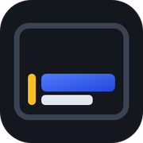

# Church Lower Thirds by Culto em Off

**Free lower thirds & overlays for church live streams in OBS Studio.** Names, a corner badge, a ticker, a QR code card for giving, the week's schedule, social handles and the church logo, all controlled from a dock inside OBS. Windows, beta. The interface is available in Portuguese (Brazil and Portugal), English, Spanish, Italian and German.

Lower thirds e overlays para transmissões de igrejas no OBS Studio: nomes, selo de canto, barra de avisos, cartão com QR Code para contribuições, agenda, redes sociais e logo, tudo controlado por um painel dentro do OBS.

**[Baixar a versão mais recente (Windows)](https://github.com/CultoemOff/Church-Lower-Thirds/releases)** · versão beta

## Como funciona

1. **O programa** roda em segundo plano no computador e inicia com o Windows.
2. **O painel** é um dock dentro do OBS: é onde se clica para mostrar e esconder cada coisa.
3. **Os gráficos** são uma fonte de navegador do OBS, com fundo transparente.

Na primeira vez, um assistente explica esses passos com ilustrações e deixa tudo pronto. As configurações ficam numa página à parte, com prévia ao vivo.

## O que tem

- **Nomes** (lower third): 15 modelos; texto escrito na hora ou salvo numa lista; logo e QR Code opcionais em cada item.
- **Selo superior**: 7 modelos, num canto da tela, com logo, nome da igreja, "AO VIVO", horário, data, dia da semana e recados; cada parte é opcional.
- **Barra inferior**: 4 modelos, com texto rolando. Os nomes sobem sozinhos quando ela está no ar.
- **Cartão QR / Oferta**: 9 modelos. A contribuição pode ser PIX (pela chave ou pelo "copia e cola" do banco), aplicativo de pagamento por telefone ou código, transferência SEPA (QR EPC), um link, uma imagem de QR Code enviada ou só os dados bancários. Também faz QR Code de qualquer link.
- **Agenda**: 4 modelos; mostra um dia por vez.
- **Redes sociais e avisos**: 7 modelos; um item por vez ou todos em sequência, com contador e linha do tempo. Os ícones são genéricos (não os logotipos das redes); a igreja pode enviar os seus.
- **Logo** no canto da tela.
- **Tema global**: cores com degradê, fonte, cantos, sombra e opacidade que todos os elementos seguem; cada elemento pode ter aparência própria. 24 modelos prontos, mostrados em miniaturas reais (com o nome e o logo da igreja), cada um com as cores sugeridas, e 29 conjuntos de cores prontas para trocar. Dez são **temáticos**: Jovem, Kids, Feminino, Coral, Banda, Natal, Natal Kids, Natal no Egito, Páscoa e Páscoa Kids, com desenhos próprios (flores, estrelas, notas musicais, estrela de Belém e manjedoura, sol e pirâmides, lírios e cruz, túmulo vazio).
- 19 fontes incluídas (`src/web/fonts`, licença SIL OFL 1.1) e todas as instaladas no computador; 11 animações de entrada e saída, entre elas gota d’água, linha que se abre e deslize com rastro.
- **Painel do OBS** com abas, responsivo, com o tempo na tela, botão de fixar e prévia.
- Posições na tela arrastando; layout horizontal e vertical; cada elemento como fonte separada ou todos numa só.
- Endereços HTTP para Stream Deck e Companion, sem plugin. Backup num arquivo.
- Atualização com um clique.

## Fontes do OBS

O programa escreve na pasta escolhida na instalação (`Documentos\Church Lower Thirds\OBS Sources`) um arquivo HTML por fonte, com nomes em inglês iguais em todo computador. Cada arquivo só espera o programa e abre o endereço correspondente.

| Arquivo | Endereço | Elemento |
|---|---|---|
| `All Elements.html` | `/source/all` | todos |
| `Names.html` | `/source/names` | nomes (lower third) |
| `Corner Badge.html` | `/source/badge` | selo superior |
| `Ticker.html` | `/source/ticker` | barra inferior |
| `QR Card.html` | `/source/qr-card` | cartão QR / oferta |
| `Schedule.html` | `/source/schedule` | agenda |
| `Social.html` | `/source/social` | redes sociais |
| `Logo.html` | `/source/logo` | logo |

Os arquivos `… (Vertical).html` abrem o mesmo endereço com `?layout=vertical` (palco de 1080 × 1920). Painel do OBS: `http://127.0.0.1:8795/dock`. Configurações: `http://127.0.0.1:8795/settings`.

A pasta `Data`, ao lado de `OBS Sources`, guarda `config.json` e as imagens.

## Instalação, usuários e atualização

- O programa fica em `C:\Program Files\Culto em Off\Church Lower Thirds`, ao lado dos outros programas do Culto em Off. Por isso o instalador pede permissão de administrador.
- **Cada usuário do Windows tem os seus arquivos e configurações.** A pasta escolhida no instalador vale para quem está usando o computador naquele momento; os outros usuários recebem `Documentos\Church Lower Thirds` no próprio perfil. O que cada conta usa fica anotado em `%APPDATA%\Church Lower Thirds\location.json` (pasta e porta).
- Com duas contas abertas ao mesmo tempo, a segunda usa a porta seguinte (8796…). Os arquivos de `OBS Sources` e o `Control Dock.html` de cada conta já apontam para a porta certa.
- **Atualização:** o painel consulta as Releases deste repositório e mostra "Atualizar agora". O programa baixa o instalador, confere o SHA-256 com o `SHA256SUMS.txt` da release, executa em modo silencioso (o Windows pede permissão) e volta sozinho. Quem usa uma versão final só recebe versões finais; quem usa beta recebe também os betas.

## Segurança

O servidor escuta só em `127.0.0.1` e confere cada pedido (`src/server/guard.ts`): o `Host` tem de ser o do próprio computador, o `Origin` tem de ser uma página do programa e pedidos vindos de outro site (`Sec-Fetch-Site: cross-site`) não chegam à API nem ao WebSocket. Ferramentas que não são navegadores (Stream Deck, Companion) continuam funcionando. Imagens enviadas são conferidas pelo conteúdo e servidas com CSP `sandbox`. A atualização só baixa por HTTPS e confere o SHA-256. Erros vão para `error.log` na pasta de dados do usuário.

## Idiomas

Os textos do código são em português do Brasil. As traduções ficam em `i18n/strings-*.txt` (cinco linhas por texto: pt-BR, inglês, espanhol, italiano, alemão) e `i18n/pt-PT.txt`; `npm run i18n` gera `src/web/js/i18n/*.js`.

## Desenvolvimento

```
npm install
npm run dev        # servidor em http://127.0.0.1:8795
npm test
npm run lint && npm run format:check && npm run typecheck
```

- `src/server`: Express + WebSocket; `pix.ts` (BR Code), `sepa.ts` (QR EPC), `guard.ts` (quem pode falar com o programa), `qr.ts` (QR em SVG), `fonts.ts` (fontes instaladas), `store.ts` (configuração e validação), `updater.ts` (atualização).
- `src/web`: páginas sem bundler (`overlay`, `dock`, `settings`).
- `installer/` e `.github/workflows/installer.yml`: instalador do Windows (Inno Setup). Cada push na `main` publica a versão do `package.json` em Releases; versões com hífen (`0.1.0-beta.1`) saem como pré-lançamento.

Sem instalador, a pasta dos arquivos é `Documentos/Church Lower Thirds` e pode ser trocada com `--folder <pasta>` ou `CLT_DATA_DIR`.

As marcas citadas pertencem aos seus donos. Este programa não é afiliado ao OBS Project.
